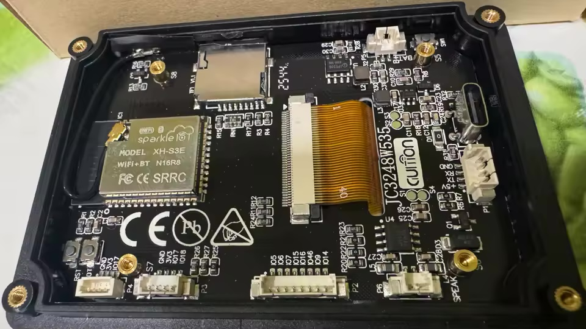
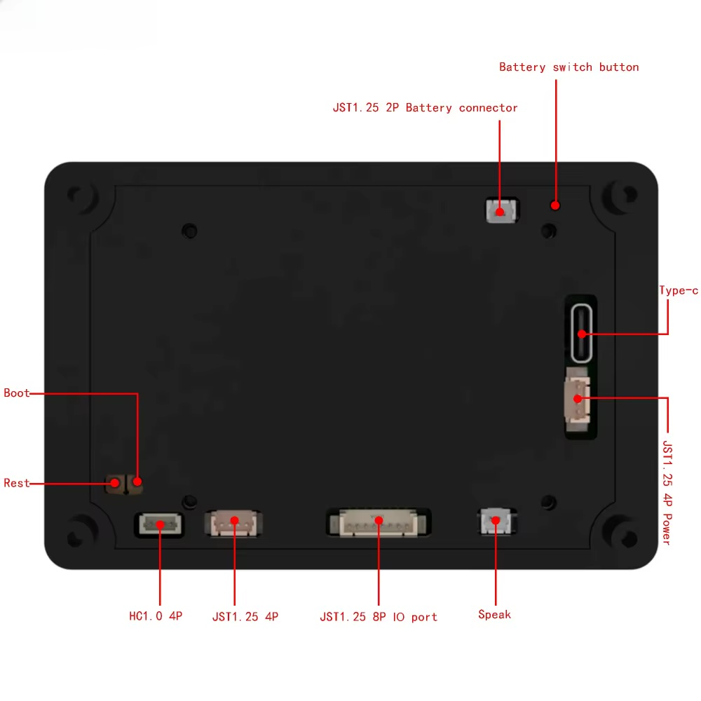

# 🛠️ Сервісний документ: Апаратні роз'єми, підключення та прошивка

**Пристрій:** Guition JC3248W535 / JC3248W535C  
**Мікроконтролер:** ESP32-S3-WROOM-1 (QFN56, 16MB Flash, 8MB Octal PSRAM)  
**Призначення:** Автономний монітор та логер акумуляторних батарей (АКБ) Vision V-LFP48100 15S LiFePO4  

---

## 📌 1. Карта роз'ємів та розпіновка друкованої плати

<p align="center">
  
  
</p>

На зворотній стороні плати JC3248W535C біля кожного роз'єму чітко нанесено заводську шовкографію з номерами GPIO:

| Роз'єм на платі | Тип конектора | Підписані піни (шовкографія) | Призначення та напруги |
|---|---|---|---|
| **P1** | JST 1.25 мм 4P | **GND \| TXD (IO43) \| RXD (IO44) \| 5V** | Інтерфейс RS-485 (MAX485), напруга 5V |
| **P3** | JST 1.25 мм 4P | **GND \| 3V3 \| IO17 (TX) \| IO18 (RX)** | Інтерфейс CAN (SN65HVD230), рідна напруга 3.3V |
| **P4** | HC 1.0 мм 4P | **GND \| 3V3 \| IO17 (TX) \| IO18 (RX)** | Дублює P3 для тонких шлейфів 1.0 мм |
| **P2** | JST 1.25 мм 8P | **IO5 \| IO6 \| IO7 \| IO15 \| IO16 \| IO46 \| IO9 \| IO14** | Додаткові вільні GPIO (керування DE/RE, датчики) |
| **BAT** | JST 1.25 мм 2P | **BAT+ (3.7–4.2V) \| GND** | Живлення від 1S Li-Ion/18650 акумулятора |
| **P6 (SPEAK)** | JST 1.25 мм 2P | **SPK+ \| SPK-** | Вихід підсилювача I2S NS4168 на динамік |
| **USB Type-C** | Type-C Receptacle | **5V, D+, D-, GND** | Програмування (CDC Serial/JTAG), основне живлення |
| **TF Slot** | Push-Pull MicroSD | **SDMMC 1-bit** | Слот картки пам'яті (FAT32 до 32 ГБ) |
| **Кнопка BAT_SW**| Тактова SMD | **Battery Switch** | Ввімкнення/вимкнення при роботі від акумулятора |
| **Кнопка BOOT** | Тактова SMD | **GPIO 0** | Вхід у режим Bootloader для аварійної прошивки |
| **Кнопка RESET**| Тактова SMD | **CHIP_PU (EN)** | Апаратне перезавантаження процесора |

---

## 🔌 2. Схема підключення модуля TTL ➔ RS485

Для безпечного зв'язку з шиною акумуляторних батарей (АКБ) використовується стандартний модуль перетворювача **TTL to RS485** (на мікросхемі MAX485, SP3485 або модуль з автоматичним контролем напрямку потоку).

### 2.1. Розпіновка кабелю від роз'єму P1 до модуля RS485:

```
  Плата JC3248W535C (Роз'єм P1)             Модуль TTL-RS485
+-------------------------------+       +-----------------------+
| Pin 1: 5V (Червоний)          | ----> | VCC                   |
| Pin 2: GPIO 43 (TXD, Жовтий)  | --X-- | НЕ ПІДКЛЮЧАТИ (Ізол.) |
| Pin 3: GPIO 44 (RXD, Білий)   | ----> | RXD (або RO)          |
| Pin 4: GND (Чорний)           | ----> | GND                   |
+-------------------------------+       +-----------------------+
```

> [!IMPORTANT]
> **ПРАВИЛО БЕЗПЕКИ ПАСИВНОГО СНІФФЕРА:**
> Пін **TXD (GPIO 43)** навмисно залишається **непідключеним**! Прилад працює у 100% пасивному режимі прослуховувача. Він лише зчитує діалог між інвертором/COM-Box та АКБ через лінію RXD (GPIO 44). Це повністю виключає апаратні конфлікти та колізії на шині зв'язку.

### 2.2. Підключення модуля RS485 до акумуляторних батарей (АКБ):

```
Модуль TTL-RS485                        Шина акумуляторних батарей (АКБ) Vision
+------------------+                   +---------------------------------------+
| Клема A (Data +) | ----------------> | Лінія A (RS485+) на роз'ємі RJ45/клемнику
| Клема B (Data -) | ----------------> | Лінія B (RS485-) на роз'ємі RJ45/клемнику
| Клема GND (Земля)| ----------------> | Загальний мінус шини зв'язку (GND)    |
+------------------+                   +---------------------------------------+
```

- **Термінатор 120 Ом:** переконайтеся, що на модулі RS485 увімкнено кінцевий резистор 120 Ом (якщо екранчик встановлено на кінці лінії зв'язку).
- **Швидкість зв'язку:** 9600 біт/с, 8 біт даних, без парності, 1 стоп-біт (9600 8N1).

---

## ⚡ 3. Варіанти живлення приладу

1. **Основний варіант (Стаціонарний):**
   - Через роз'єм **USB Type-C**: будь-який блок живлення 5V $\ge$ 1A (або порт USB інвертора).
2. **Промисловий варіант (У щитку):**
   - Від шини 48V через понижуючий DC-DC перетворювач (наприклад, 48V ➔ 5V 2A), подавши +5V та GND безпосередньо на контакти роз'єму P1 або на роз'єм Type-C.
3. **Резервний варіант (Автономний):**
   - Додатковий плоский акумулятор 3.7V Li-Ion підключається до 2-пінового гнізда `BAT`. На платі є вбудований контролер заряду: при підключенні Type-C батарея заряджатиметься автоматично.

---

## 💻 4. Сервісна процедура прошивки та оновлення ПЗ

Плата містить вбудований апаратний інтерфейс **USB-Serial/JTAG** процесора ESP32-S3, тому додаткові USB-UART перехідники (CH340/CP2102) не потрібні.

### 4.1. Стандартна прошивка через PlatformIO:
1. Підключіть плату звичайним дата-кабелем USB Type-C до комп'ютера (Mac / Windows / Linux).
2. У терміналі комп'ютера перевірте визначення порту:
   - **macOS:** `/dev/cu.usbmodem101` або `/dev/cu.usbmodem*`
   - **Linux:** `/dev/ttyACM0`
   - **Windows:** `COM3` (або інший номер у диспетчері пристроїв)
3. Виконайте збірку та прошивку:
   ```bash
   pio run -t upload --upload-port /dev/cu.usbmodem101
   ```
4. Після завершення прошивки пристрій перезавантажиться автоматично.

### 4.2. Примусове введення в режим Bootloader (Якщо плата зависла або не прошивається):
Якщо прошивка перервалася або плата не відповідає:
1. Затисніть кнопку **`BOOT`** на зворотній стороні плати.
2. Не відпускаючи `BOOT`, коротко натисніть кнопку **`RESET`**.
3. Відпустіть кнопку **`BOOT`**.
4. Плата гарантовано увійде в режим завантажувача (`ROM Download Mode`), після чого прошивка успішно запишеться.

---

## 🔒 5. Підготовка карти пам'яті MicroSD (SD Card Formatter)

Для надійного запису CSV-логів та сумісності з апаратним 1-бітним контролером SDMMC ESP32-S3 (GPIO 11, 12, 13) картка пам'яті MicroSD має бути правильно відформатована.

> [!WARNING]
> Стандартні утиліти форматування Windows Explorer або macOS Disk Utility часто створюють нестандартні GUID/EFI розділи, приховані службові файли або неоптимальний розмір кластера, що спричиняє помилку монтування `f_mount failed` або збої під час циклічного запису в ESP-IDF/Arduino FatFS.

### Рекомендована процедура підготовки:
1. Завантажте офіційну безкоштовну утиліту **[SD Card Formatter від SD Association](https://www.sdcard.org/downloads/formatter/)** (Windows / macOS).
2. Вставте картку MicroSD (рекомендується Class 10 / UHS-I, об'єм від 4 ГБ до 32 ГБ).
3. У полі **Formatting options** виберіть:
   - **Overwrite format** (повне затирання попередньої розмітки та таблиць розділів, очищення бітів зносу).
   - Volume label: залиште порожнім або вкажіть коротку назву англійською (наприклад, `BMS_LOGS`).
4. Натисніть **Format**.
5. Картка буде розмічена в чистому **FAT32 MBR** зі стандартним розміром кластера 32 КБ.
6. Вставте картку у слот `TF CARD` на платі при вимкненому живленні.

---

## 🔒 6. Повне аварійне відновлення (Factory Restore)

У репозиторії проекту збережено точний заводський бінарний дамп Flash-пам'яті (16 МБ), знятий з плати до внесення будь-яких змін:
`backup/jc3248w535c_factory_full_16MB.bin`

### Команда повного відновлення заводського образу:
```bash
# Через готовий скрипт:
./restore_factory.sh

# Або напряму через esptool:
esptool.py --chip esp32s3 -p /dev/cu.usbmodem101 -b 921600 write_flash 0x0 backup/jc3248w535c_factory_full_16MB.bin
```
Ця операція повертає на плату оригінальний заводський бутлоадер, калібрування сенсора, заводські демо-ролики та графічний інтерфейс виробника Guition.

---

## 📋 7. Зведена таблиця GPIO ESP32-S3

| GPIO | Функціонал | Примітка |
|---|---|---|
| **GPIO 1** | LCD_BL (ШІМ підсвічування) | Частота 5 кГц, регулювання яскравості |
| **GPIO 2** | I2S_WS (LRCK) | Аудіо синхронізація слів |
| **GPIO 4** | TOUCH_SDA | Дані шини I2C тачскріну |
| **GPIO 8** | TOUCH_SCL | Тактування шини I2C тачскріну |
| **GPIO 11** | SD_CMD / TOUCH_INT | Команда MicroSD / Переривання тачскріну |
| **GPIO 12** | SD_CLK / TOUCH_RST | Тактування MicroSD / Скидання тачскріну |
| **GPIO 13** | SD_D0 | Шина даних MicroSD (1-bit mode) |
| **GPIO 19, 20** | USB D-, D+ | Вбудований інтерфейс USB-JTAG/CDC |
| **GPIO 21, 39, 40, 48** | LCD_D0 .. D3 | 4-бітна шина даних QSPI дисплея |
| **GPIO 41** | I2S_DOUT | Аудіо потік даних (MAX98357A / NS4168) |
| **GPIO 42** | I2S_BCK | Тактування аудіо бітів |
| **GPIO 43** | RS485_TX | **ВИМКНЕНО (Безпека шини)** |
| **GPIO 44** | RS485_RX | **ВХІД ПАСИВНОГО СНІФФЕРА (9600 8N1)** |
| **GPIO 45** | LCD_CS | Вибір чіпа дисплея AXS15231B |
| **GPIO 47** | LCD_SCLK | Тактування QSPI дисплея |

---
*Документ призначений для інженерів, монтажників та сервісних фахівців.*
